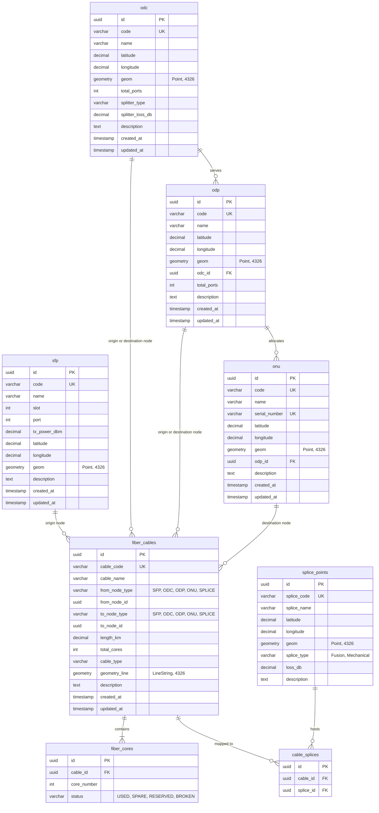

# Entity Relationship Diagram (ERD)

This directory documents the database architecture for **FTTH Network Mapper & Optical Loss Analysis**. 

## Relational Rules

1. **Logical Hierarchy**: 
   - SFPs are OLT laser ports that initiate GPON logical loops.
   - ODC cabinets host the main Splitters (e.g., `1:16` or `1:32` splitting ratios), generating a large insertion loss of `10dB` to `17dB`.
   - ODP cabinet enclosures act as drop-wire hubs servicing individual blocks. Each ODP maps back upstream to a specific ODC via `odp.odc_id`.
   - ONUs represent final subscriber receivers, linked back to an ODP port via `onu.odp_id`.

2. **Physical Geography (PostGIS Integration)**:
   - SFPs, ODCs, ODPs, ONUs, and Splices are localized via `latitude` and `longitude`. The system automatically maintains spatial geometry point columns (`geom`) via database triggers.
   - Cables representing route guidelines are stored as Polylines (`GEOMETRY(LineString, 4326)`) tracking intermediate wire turns.

3. **Core Splicing Joint**:
   - `cable_splices` is a many-to-many lookup connecting cables passing through particular joint points (`splice_points`). Splicing loss values dynamically add up to the fiber core signal budget.
